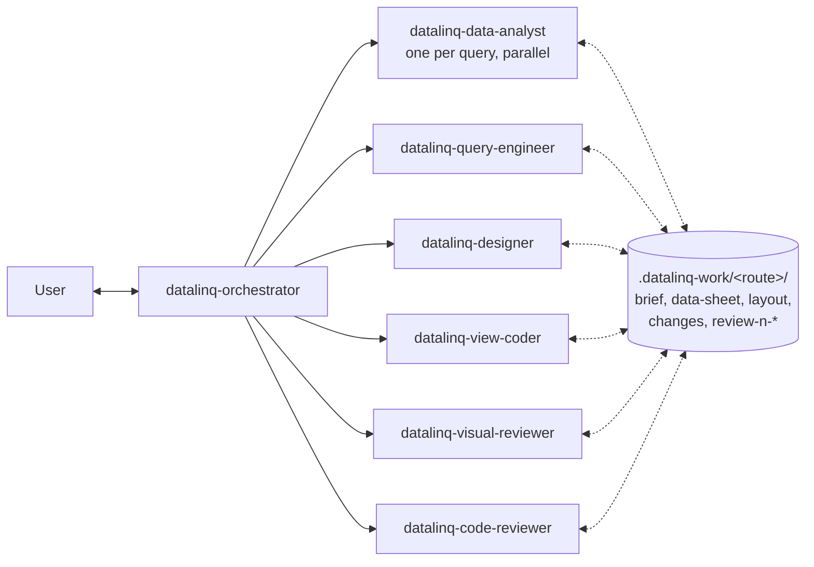

# DataLinq custom agents (multi-agent mode)

Optional team of custom agents on top of the DataLinq skills (`../skills`). The skills hold the knowledge; the agents split the work into roles with **separate context windows** and **least-privilege tools**, so that the reviewer judges the result without the author's bias and each agent only loads what its role needs.

The skills keep working without these agents (single-agent mode).



| Agent | Role | Writes (DataLinq) | Approvals |
|---|---|---|---|
| `datalinq-orchestrator` | talks to the user, brief + acceptance checklist, delegates, decides "done" | - | preview link for the user |
| `datalinq-data-analyst` | data sheet per query | - | `sample_query`, `run_sql_preview` |
| `datalinq-query-engineer` | new/changed queries | queries | `create_query`, `update_query`, ... |
| `datalinq-designer` | image/description -> `layout.md` | - | none |
| `datalinq-view-coder` | create/patch views, undo log | views | saves |
| `datalinq-visual-reviewer` | preview + check script + screenshots vs. checklist | - | `get_preview_link` |
| `datalinq-code-reviewer` | static rules (API, columns, security, structure) | - | none |

The loop, the work-folder files and the definition of done are defined once in `../skills/datalinq-connect/references/workflow.md`.

## How a request runs

1. User asks the orchestrator (e.g. *"Build a PDF invoice for `shop@orders`, here is our old one"*).
2. Orchestrator connects, clarifies, writes `brief.md` with an acceptance checklist and lets the user confirm it.
3. Data analysts (parallel, one per query) -> `data-sheet.md`; query engineer if data is missing.
4. Designer -> `layout.md` (with an image).
5. View coder -> `verify_view` -> save (user approves) -> `changes.md`.
6. Visual reviewer and code reviewer **in parallel** -> `review-<n>-visual.md`, `review-<n>-code.md`.
7. Findings -> coder fixes (max 3 rounds) -> reviewers again.
8. Orchestrator shows the preview + summary and asks for feedback; feedback becomes checklist items -> 5.

### Why this reduces bias and context

- Reviewers start from the brief, data sheet and the rendered result only - never from the coder's transcript.
- Every finding must cite a checklist item or evidence; the coder never declares its own work done.
- Each agent loads only its skill(s); large outputs (rows, screenshots, code) stay in the subagent's context, only short summaries and files flow back.

## Installation

Install the skills first (see `../skills/datalinq-pdf-report/README.md` / `../skills/datalinq-dashboard/README.md`) and configure the `datalinq` MCP server (and ideally the `playwright` MCP server for the visual reviewer).

| Client | Copy | Start |
|---|---|---|
| VS Code (GitHub Copilot) | `copilot/*.agent.md` -> `.github/agents/` (workspace) or `~/.copilot/agents/` (user) | pick **datalinq-orchestrator** in the agent picker |
| Copilot CLI | `copilot/*.agent.md` -> `.github/agents/` or `~/.copilot/agents/` | `/agent` -> datalinq-orchestrator, or `copilot --agent datalinq-orchestrator` |
| Claude Code | `claude/*.md` -> `.claude/agents/` or `~/.claude/agents/` | `claude --agent datalinq-orchestrator` (runs the orchestrator as main thread so it can spawn the others) |

- Only the orchestrator is user-invocable; the other agents are subagents (`user-invocable: false` in Copilot).
- **Models:** no agent pins a model. All agents and subagents use the model the user started the chat with.
- Add `.datalinq-work/` to the `.gitignore` of the workspace you work in (the orchestrator does this if missing).
- MCP server names must be `datalinq` and `playwright`, because tool lists reference `datalinq/<tool>` (Copilot) / `mcp__datalinq__<tool>` (Claude). Using other names: adjust the `tools` lists.

## Editing the agents

`copilot/*.agent.md` is the single source. After a change regenerate the Claude files:

```powershell
pwsh ./agents/sync-claude-agents.ps1
```

The script maps tool aliases (`read`, `edit`, `search`, `todo`, `agent` + `agents:`), MCP tools (`datalinq/x` -> `mcp__datalinq__x`) and adds the Claude `skills:` preload list (defined in the script).

## Caveats

- **Approval dialogs from subagents.** The DataLinq server asks the user via MCP elicitation for every query run and save, no matter which agent calls. Verified in the GitHub Copilot app (interactive mode): dialogs raised by a subagent are shown to the user. For other clients check once; if dialogs from subagents are not shown, run in single-agent mode (use the skills directly). The orchestrator never starts two approval-heavy subagents at the same time.
- **Unattended / autopilot sessions.** Clients that answer prompts automatically while the user is away (e.g. autopilot mode in the GitHub Copilot app) return the approval as not approved - the server then executes nothing. Run DataLinq sessions in interactive mode when queries or saves are needed.
- **"Don't ask again"** is remembered per MCP session. If a client opens a separate MCP session per subagent, the user is asked again by each agent.
- **Preview links** are single use - each reviewer requests its own.
- **Never two writers on one view.** Parallelism is limited to analysts (different queries) and the two reviewers (read-only).
- Handoffs (VS Code `handoffs:`) are not used, because they switch the active agent; delegation uses subagents so the orchestrator keeps the conversation.
